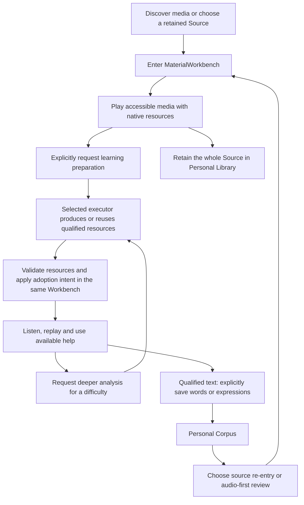

# Learner Journeys

> Owner-approved target journey, updated 2026-10-22. This describes intended
> desktop/mobile behavior, not completed implementation or acceptance results.

[STATE.md](STATE.md) owns current support and gaps; [ROADMAP.md](ROADMAP.md)
owns execution order. [MODEL.md](MODEL.md#4-resource-policy-and-readiness)
owns the foundational/on-demand resource requirements and current type mapping.
The [devices and production design](docs/architecture/devices-and-production.md)
owns executor placement and delivery design.

The journey begins with media, not a mandatory production task:



This is not a mandatory sequence: a material may arrive with qualified learning
resources already available, a Learner may only watch, and a retained Source or
Corpus Entry can be reopened directly. Task progress and resource availability
do not themselves constitute learning or acquisition evidence.

## Discover or bring audio/video

1. Browse available content sources, follow a supported link, import a local
   audio/video file, or share one from the mobile system into Listen. Show known
   title, source, duration, native tracks, and availability without claiming
   that discovery has already acquired the media or prepared learning resources.
2. Keep Source identity, authorization, access, retention, and exact asset
   binding distinct. A link accessible on the phone may need separate access
   or file transfer before the selected executor can obtain its bytes.
3. Choose a media item to enter MaterialWorkbench directly. Standalone document
   material is deferred; accompanying subtitles are valid media inputs.

## Watch or listen before preparation

1. Use accessible source media, its audio tracks, supplied subtitles, and
   chapters where available. Do not require Gen, a model download, or a qualified
   Learning Edition just to enter the Workbench and play native media.
2. Provide ordinary playback: pause/resume, seek, rate adjustment, video
   fullscreen, and position persistence. Mobile audio also needs appropriate
   background and lock-screen behavior; desktop and mobile adapt interaction
   while keeping shared semantics.
3. If the media cannot yet play, show acquisition/download, unavailable input,
   or recovery in the same workspace. Do not substitute a transcription task
   for obtaining playable media. Offline playback requires local media bytes.
4. Supplied subtitles may be displayed as native support. Qualifying them as
   learning text or timing requires normalization and exact compatibility checks;
   display alone does not establish stable anchors or precise word timing.
5. Keep playback progress across closing and reopening. Watching, pausing, and
   opening native subtitles do not automatically add Personal Corpus entries,
   create completed learning attempts, or prove vocabulary capability.

## Retain and return to the whole material

1. Explicitly retain an interesting whole Source in the Personal Library before
   or after preparing learning resources. This can support continue-watching,
   choosing an offline copy, or requesting preparation later.
2. Opening media, retaining it, downloading bytes, and preparing learning
   resources are distinct actions. A library entry is not a Personal Corpus
   Entry and no meaningful phrase is inferred from retention alone.
3. Reopen the same Workbench from the library, preserving the Source, exact
   media context, position, and known resource readiness. Removing an offline
   copy changes availability without erasing retained relationships or history.

## Request foundational learning resources

1. Choose preparation in the current Workbench using configured executor,
   language, and provider choices. Do not make the Learner configure a pipeline
   for every material. Production is explicit, not triggered just by playback.
2. Request qualified interactive text with stable anchors, precise sentence/
   word timing bound to the exact media, and Sentence Translation in declared
   Support Languages. Reuse compatible existing inputs and produce only gaps;
   native subtitles do not force unnecessary ASR when they can be qualified.
3. Persist the request independently of this page. Show waiting for an executor,
   acquiring input, processing, failure, retry, and cancellation honestly. The
   Learner can keep watching or leave without losing the task or playback context.
4. Receive typed, versioned results through Core validation and installation.
   Apply the Learner's adoption intent; never interpret provider output directly
   or silently replace an already adopted incompatible composition.
5. Arrival of resources updates the same Workbench without forced navigation or
   restarting playback. Production failure or cancellation leaves previously
   available media and resources usable. Readiness is based on resources, not
   successful process exit or a schema-valid package alone.

## Use what is ready, with honest readiness

| Assessment | Learner experience |
|---|---|
| Playable | Normal playback using accessible native media and resources |
| Some qualified learning resources available | Open only the actions whose exact dependencies are ready; name missing foundations |
| Foundational learning ready | Interactive text, exact sentence/word alignment, and declared translations are qualified and usable |
| Requested on-demand result ready | Add the requested analysis or explanation to the existing experience |

These assessments coexist; they are not one irreversible status ladder.
Device-local availability is separate from a producer having generated a result.
Qualified text can enable word/phrase selection and saving before translation
finishes. Original-audio Slice replay also requires accurate alignment. A failed
translation must not yield foundational readiness; an absent phone/prosody
analysis does not invalidate otherwise ready foundational learning.

## Listen and resolve a difficulty

1. Listen for meaning in the current material. Narrow attention to a sentence
   or smaller text-backed range as needed, then replay, loop, or adjust speed.
2. Use exact interactive text and sentence translation when needed. Keep them
   grounded in the same canonical text and recording rather than a detached
   transcript or another speaker's timings.
3. Select a word/expression for lookup or reference pronunciation, or request
   Sense Groups, grammar/context explanation, acoustics, prosody, or phone
   analysis for the actual difficulty. A sentence or selected Slice can be the
   request scope; processing the whole recording is not mandatory.
4. Reuse qualified existing results. Missing optional help can be requested
   from the selected executor and remain honestly waiting or unavailable. It
   does not block basic listening, replay, existing text, or translation.
5. Present the minimum useful help and return to the same sound. The goal is a
   better second act of listening, not consumption of phonetic labels.
6. Record explicit judgments, outcomes, and assistance actually used. Direct
   hearing checks such as dictation/cloze can serve this journey; independent
   reading/writing/speaking, output assessment, shadowing recording, AI
   conversation, and learning-coach policies remain deferred.

## Save meaningful language only with qualified text

1. With qualified text and stable anchors available, explicitly save a useful
   or difficult word, expression, sentence, or text-backed bounded Slice.
   A finished exercise or every on-demand analysis is not a prerequisite.
2. Without qualified text, offer whole-Source retention and normal playback,
   but do not create a textless audio-range Personal Corpus Entry. Native
   subtitle display alone is not proof that this requirement is met.
3. Preserve the exact Material Revision, canonical text span, context, and
   Learner Relation. Include an exact audio rendition/range only when compatible
   alignment exists. Do not invent locators or silently bind later text/timings
   to a different cut or recording.
4. Original-audio replay is enabled only with accurate mapping and available
   media. A missing optional analysis must not prevent text-backed saving;
   insufficient alignment must not masquerade as original-audio replay support.
5. A Slice normally remains a reference into the original material rather than
   a copied clip, with this route:

   ```text
   saved language -> exact text/audio context -> surrounding context -> whole material
   ```

6. Keep meaningful relations and history; collection is intentional. The
   Personal Corpus is distinct from a retained-media library and from the
   Learner's own production corpus, which remains outside the active scope.

## Return through the Personal Corpus

1. Browse or search saved language, inspect context and history, and choose an
   entry to reopen or review. No coach recommendation or automatic upgrade
   policy is needed to choose the next action.
2. Return to the same MaterialWorkbench with the retained text span, exact
   revision, relevant history, and audio range when supported. Expand outward
   to surrounding sentences or the whole material without losing the entry.
3. If media is absent on this device, show missing/offline resources and offer
   recovery. Preserve the entry and readable qualified text; do not erase it
   or play a different recording as if its locators were compatible.
4. Further occurrences can provide additional listening contexts. Search
   indexes are replaceable projections, not the authority for learner history.

## Review through re-perception

1. Explicitly choose an audio-backed saved entry or use the narrow FSRS due
   queue. Accurate alignment and available original media are prerequisites
   for this audio-first review; unsupported entries keep honest availability.
2. Begin with original audio, initially withholding text/translation. Replay
   or narrow focus before revealing more support.
3. Use an already available perceptual cue or request useful optional help.
   A missing cue can be skipped in favor of available text/translation; review
   must not require generating every deeper analysis first.
4. Return to the audio after useful help. Record the support actually used and
   the Learner's explicit outcome/rating. Scheduling determines when to return,
   not a fixed choreography or automatic proof of capability.
5. Preserve the difference between familiarity with this recording and transfer
   to another sentence, speaker, rate, or context. Listening success never
   silently establishes reading, speaking, or writing capability.

## Continue across devices and production locations

1. A phone can open native media and request computer preparation from the same
   Workbench. Send links as references or transfer local input when needed.
   A sleeping/offline personal computer leaves a durable waiting task.
2. The selected executor may be the personal computer or, later, a remote
   production service. Local models, vendor APIs, and mixed computation use
   the same qualification and delivery semantics. A vendor API alone does
   not move task orchestration off the personal computer.
3. Deliver compatible resources to the requesting device automatically through
   the configured path. Distinguish production completion, transfer, validation,
   adoption, foundational readiness, and per-device offline availability.
4. Keep progress visible while foregrounded. Notifications are hints; reopening
   reconciles task/results even if no notification or background download ran.
5. With required resources local, disconnect the phone and turn off the computer.
   Listen, use existing help, save text-backed Slices, browse the Personal
   Corpus, and review offline. New computation may wait without blocking this.
6. Reconnect and exchange private records. The computer can re-enter the same
   retained language and history. Duplicate delivery does not duplicate facts;
   correction/conflict and review scheduling use shared Core rules instead of
   overwriting whole database files.

## Acceptance scenarios

- Open accessible media with no Gen or models available: enter the Workbench,
  use native playback, leave/reopen, and preserve position.
- Reuse qualified native subtitles while producing missing foundations; keep
  the same media context and avoid unnecessary retranscription.
- Finish text while translation/timing remains incomplete: enable only
  dependency-satisfied actions and do not claim foundational readiness.
- Finish all foundations without deep acoustic/phone/prosody analysis: use
  basic listening; an optional analysis failure leaves that experience intact.
- Try collecting before text qualification: whole-Source retention is available,
  textless audio-range Corpus saving is unavailable. After text qualification,
  save a Slice; original-audio re-entry still checks alignment and local media.
- Request preparation, close the page, interrupt transport, reconnect, and
  retry/cancel: preserve task identity, earlier resources, and playback context;
  late results never overwrite current intent or adopted incompatible material.
- Complete the macOS/Android journey with model-free providers, then learn and
  review offline, return private records, and reopen the original Slice on the
  computer. Later validate remote production with the personal computer off.
- Change resource versions or remove an offline media copy: preserve exact
  history/anchors and show incompatibility or unavailability without silent rebinding.

## Experience invariants

- One Core-backed Workbench hosts native playback, preparation, learning, and
  Corpus re-entry; entry never requires completed resource production.
- Qualified text, exact timing, and declared Sentence Translation establish
  foundational listening readiness. Deeper analysis is on demand.
- Actions use their own qualified dependencies; partial readiness, material
  qualification, and device-local availability remain different assessments.
- Corpus saving is text-backed; source replay additionally checks exact media
  mapping. Native viewing or whole-material retention does not create a Slice.
- Resources preserve revision compatibility, provenance, and honest evidence.
  Predictions, Sense Groups, and observed acoustic boundaries remain distinct.
- Native playback, preparation progress, and clickstream never silently become
  mastery, learner state, or independent evidence in another capability dimension.
- Prepared local learning and durable learner facts outlive production
  executors, model providers, resource caches, and individual media downloads.
