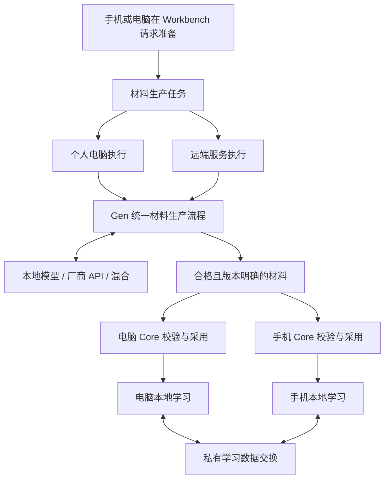

# 双端、本地优先与可替换材料生产

> 状态：用户于 2026-10-22 批准的建设方案，尚未完成实现。

本文是双端部署、材料生产与交付方式的目标方案。
[产品原则](../../PRODUCT.md)和[领域模型](../../MODEL.md)定义产品语义；
[职责地图](../../CONTEXT-MAP.md)定义归属；
[用户旅程](../../JOURNEYS.md)定义体验；
[当前状态](../../STATE.md)和[路线图](../../ROADMAP.md)定义实现现状与顺序。
[领域词汇](../../DOMAIN.zh-CN.md)统一材料生产任务、生产执行端和模型提供方的含义。
[运行架构](runtime.md)单独描述现有构建，不把本方案视为已实现能力。

## 目标与范围

每日英语听力作为竞品体验参照；Listen 的建设选择是本地优先、可替换的材料生产，
以及贯穿两端的学习与个人语料库旅程。

电脑与移动端共同构成一个本地优先的学习产品。两端都能发现材料、提交生产任务，
并在本地学习、收藏、进入个人语料库和复习。重型材料生产可以交给个人电脑，也可以
交给自建或托管的远端生产服务；模型计算可以使用本地模型、厂商 API 或两者混合。

本地优先保证已准备好的材料和个人学习数据能够在本机使用，不要求所有计算都在本机
发生。材料下载完成后，电脑关机、生产服务离线或手机断网，不应阻止已有内容的学习。

选择媒体后直接进入 MaterialWorkbench，用原生媒体及自带资源正常播放，不要求先生成
学习资源。用户可以在同一空间请求准备，继续观看或离开；资源合格就绪后开放相应操作，
不切换成另一份材料或强制重启播放。基础与按需资源的唯一划分及现有类型映射见
[领域模型](../../MODEL.md#4-resource-policy-and-readiness)，完整体验见
[用户旅程](../../JOURNEYS.md)。

当前活动范围仍是音视频听力。文字表征和学习帮助服务于听力；独立读写说活动、文档
材料、AI 对话和学习教练继续留在保留分支。词汇的听说读写四维状态仍是共享领域模型，
不能把活动范围收缩解释为删除这些维度；界面恢复属于后续修复。

设计与验收同时考虑桌面和移动。首个实现组合使用现有 macOS 与 Android 环境；
其他桌面系统与 iOS 的适配顺序另行确定，不将当前 macOS 进程组装方式视为所有平台
必须遵守的运行方式。

## 生产执行端与模型提供方

**生产执行端（Production Executor）**接收持久的材料生产任务，取得输入，组织 Gen
执行，并交付结果。**模型提供方（Model Provider）**完成某项转写、翻译或分析计算。
两者独立选择，厂商的单项模型 API 本身不等于完整的材料生产服务。

| 方式 | 生产执行端 | 模型计算 | 是否依赖个人电脑在线 |
|---|---|---|---|
| 本机生产 | 个人电脑 | 本地模型 | 是 |
| 混合生产 | 个人电脑 | 厂商 API，或本地与 API 混用 | 是 |
| 远端生产 | 自建或托管生产服务 | 远端模型、厂商 API，或混用 | 否 |

用户日常只需选择内容并请求准备学习。默认执行端、模型方案、发送数据范围和费用限制
在设置中管理，并允许按任务调整。执行端离线时保留等待状态；切换到收费计算必须遵循
用户明确选择的规则，不能用静默付费回退掩盖等待或失败。

## 一条可恢复的材料生产与交付流程

1. 手机或电脑提交来源、语言、所需材料契约和执行选择。链接由执行端取得内容；
   手机独有的本地文件先传输为执行端可用的输入。链接可访问性和确切输入身份必须
   诚实确认，提交一个 URL 不等于另一台设备已经获得原材料。
2. 任务以稳定身份持久保存。执行端接单后获取和绑定确切输入，运行 Gen，记录进度、
   失败、取消、重试和结果关联。重复投递或点击不能造成重复材料安装或重复计费操作；
   无法确认厂商请求结果时应明确报告，而非宣称网络层保证恰好执行一次。
3. Gen 输出带版本、输入关联、兼容性和溯源的 Content Package。不同执行端与模型
   遵守同一基础材料契约和资源依赖规则；按需分析只交付本次声明的合格结果，不要求
   每次执行所有分析。模型厂商的原始返回不能直接成为 Workbench 的材料。
4. 接收端校验、安装并沿用 Core 的明确采用语义。交付新结果不能悄悄替换已经采用的
   材料或改写学习事实。用户请求生产可以触发自动交付，但不能绕过材料有效性检查。
5. 接收端取得并校验基础契约的全部必需资源后，显示基础学习就绪。部分资源先开放
   满足其依赖的操作；按需结果另行显示就绪，不阻断基础体验，也不能掩盖基础缺项。
   精确时间或翻译不合格时不能声称基础资源已齐全，普通播放继续可用。

生产任务与各设备的交付状态分别记录。生产侧可以处于等待执行端、获取输入、处理、
成功、失败或取消；每台接收设备另有待交付、传输、校验和本机就绪状态。电脑处理完成
不意味着手机已经可离线使用。这里描述业务阶段，不规定现有协议枚举或数据库字段。

关闭提交页面、临时断网和进程重启后仍能查询、继续或恢复任务。执行端需要持久任务
队列，允许后台工作时不依赖生产界面存活；个人电脑关机或休眠时明确等待其上线。
任务取消或更换执行尝试后，迟到的结果不得覆盖当前任务决定或已有材料采用关系。

## 两端本地学习

| 能力 | 电脑 | 手机 |
|---|---|---|
| 发现来源、提交任务、查看进度 | 支持 | 支持 |
| Gen、重型模型、外部生产工具 | 可本地运行或委托远端 | 默认不携带，委托执行端 |
| Workbench、播放、字幕、循环和已有帮助 | 本地可用 | 本地可用 |
| 收藏、个人语料库、学习事实和复习 | 本地保存 | 本地保存 |
| 材料存储 | 通常保留完整资源，仍由用户控制 | 选择随身材料，明确离线完整性 |

基础文本、精确句/词时间对齐及所声明语言的翻译在请求准备时补齐，合格自带资源优先复用。
深入声音分析、意群和解释按需生产并复用；学习时根据当前困难选择帮助。新的推理请求
交给选定执行端，明确等待与不可用状态，不阻碍已有资源支持的学习。Gen 不接管
学习者相对的帮助选择、个人语料库事实或复习规则。

个人资料库可以保留尚无学习文本的整份来源。个人语料库的词句/片段保存必须有合格文本
和稳定锚点，带原声定位与回放还需精确对齐；不提供无文本音频区间的个人语料条目。

共享学习逻辑与持久化规则应从重型生产依赖中分离。目标是移动端使用轻量本地 Core，
不在 Dart 或手机原生代码中复制另一套学习规则。优先验证 Rust 学习模块的本地库嵌入；
具体桥接和依赖裁剪由双端验证决定。桌面可先保留现有 Core 子进程适配。
MaterialWorkbench 共享消费语义，布局、触摸、键盘和平台媒体行为分别适配。

## 三类交换数据

| 类别 | 目标与约束 |
|---|---|
| 生产任务 | 持久投递、接单、进度、取消、重试和结果关联；不充当学习记录 |
| 材料资源 | 版本明确、内容校验、去重、缺失资源清单和断点续传；按需选择媒体版本 |
| 私有学习数据 | 离线新增与后续合并收藏、切片、笔记、经历、判断、能力历史和复习记录 |

不通过覆盖整个 SQLite 文件合并两端数据。业务记录需要稳定身份、重复投递去重和
明确的更正、删除与冲突语义。复习尝试保留事实，调度由共同规则重建或协调；不能简单
覆盖两端的日程。播放续接不能用最大时间位置代替用户当前的学习选择。

学习事实引用确切的 Material Revision 和切片坐标。移除手机离线媒体只改变可用性，
不删除收藏或历史；仍保留返回原材料的路径以及诚实的不可用状态。索引和缓存可以重建。
公开材料分发与私有数据交换采用不同的访问、保留和删除语义；普通材料包不包含私人
学习历史、服务凭据或模型运行时。

## 网络与后台交付

配对后优先局域网直连。异地网络和两端上线时间不同的场景使用可选中转暂存任务与
结果；中转可以独立于生产执行端部署，不要求计算或学习数据库迁往云端。
远端生产交付与个人设备之间的传输遵守同样的材料校验规则。

跨设备访问需要单独的已配对、经过认证的通道；不能直接把当前本机 loopback Core
监听器暴露到网络上。远端请求明确说明素材发送范围和费用规则；凭据由执行端安全管理，
不跟随材料交付。中转的数据访问和保留策略要与私人任务、私人材料的性质一致。

前台可持续跟踪进度并领取结果；后台使用平台允许的传输与通知机制。通知只提示状态
变化，不作为唯一任务记录或交付凭证。重新打开应用主动核对与领取；不承诺所有平台
都能在生产完成后立即唤醒并下载。手机就绪时间同时受执行端在线、输入获取、生产耗时、
传输和系统调度影响。

通过复用合格资源、只传缺失内容、按需选择兼容媒体版本和恢复中断传输缩短等待；
选择音频版本时必须确实存在经过验证的音频呈现及相应映射，不能从视频身份推定可用。

## 分阶段验收与尚未决定的事项

实施顺序由 [ROADMAP.md](../../ROADMAP.md)维护：先跑通手机提交、电脑生产、自动
交付、手机离线学习、学习记录返回电脑的旅程，同时验证生产前的同一 Workbench 原生
播放、基础资源补齐、按需分析和文本就绪后的收藏；再验证电脑组织厂商 API 的混合生产；
之后增加远端执行与异地交付，验证个人电脑关机仍能准备新材料。

实现验证使用确定性生产替身，不要求调用收费模型或下载权重。生产与交付能力必须通过
两端真实运行验收，不能用桌面测试或静态移动布局截图替代。

具体云厂商、托管方式、配对协议、远端任务协议、后台驻留实现、冲突算法和跨平台桥接
尚未选定。三种生产方式是可替换目标，不要求第一轮同时建设完毕；也不引入社区发布、
订阅、推荐或完整账户体系作为首个闭环的前置条件。
