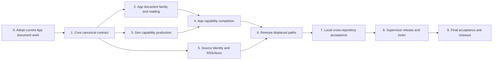

# Phase 1 Completion Plan

> Status: historical as of 2026-08-24. This plan was written for the
> superseded partial-material/capability-completion model. Do not execute it as
> the active project plan without replacing or explicitly reconciling it with
> [MODEL.md](../MODEL.md) and Roadmap Phase 1: Complete Learning Material Alpha.
>
> Former scope: all work remaining before the first accepted Phase 1 stack
> release.
> `ROADMAP.md` owned the outcome and exit conditions at the time; this file
> records the former execution order and may inform its replacement.

> Validation update, 2026-08-14: Slices 0–7 have produced an unreleased
> integration candidate, but Phase 1 is not accepted. Do not begin with another
> exhaustive cross-repository diff audit or treat implementation-agent test
> reports as product acceptance. Current validation proceeds outside-in from
> real App use and Information Architecture observation under
> [phase-1-product-validation-and-ia.md](phase-1-product-validation-and-ia.md).
> Findings from that session determine any corrective implementation slices;
> release and closeout remain blocked until the same learner journeys pass on
> the installed, pinned stack.

## Objective

Deliver one material-centered, single-device loop in which a learner can open or
discover a document, audio, or video Material; use any already available Read,
Listen, or Watch capability immediately; request a missing capability; install
and explicitly adopt the resulting coherent Learning Edition; retain the
Material; and reopen it after restart.

The target is not a universal conversion pipeline. A Material remains valid
with any supported subset of modalities. Capability Completion derives the
smallest missing set of exact Renditions and Resources for the learner's
requested experience.

## Verified starting point

This checkpoint was read from the real repositories on 2026-08-11 before this
plan was written. The implementation agent must report any later difference
rather than forcing a checkout back to these commits.

- App is on `codex/document-direct-view` at
  `897a4c61e2477d79c163d60b6042ee0bc2d6c40a`, equal to `origin/main`, with the
  uncommitted Document Stage B work that this plan explicitly preserves.
- App pins Core commit `5a65b2735325aac18f1eacb736b8d9676adf59a9`,
  contract `3.2.0`, and runtime `0.7.0` from release
  `v0.7.0-phase1.2`. Do not advance this production lock before Slice 8.
- App pins Gen source `a660946a4410c6c6b6e720ecdd02e7a88d16e5dc`,
  tool `0.4.0`, machine protocol v1, and Content Package v1. Its canonical
  package digest is already reported stale by App repository diagnostics; do
  not repair it to another pre-Phase-1 value as intermediate work.
- Core's clean local feature branch is at
  `ff73322440b6ad88c8ce713390aaa7b1e1b83918`; `origin/main` is the merge
  `c9773ade3bcf60c75f718df017fd79a113f465cf`. Core source already contains the
  3.3 Material Package Installation and Edition Adoption work, which must be
  evolved rather than reimplemented as a parallel subsystem.
- Gen's clean local v2 branch is at
  `0f690222ab42765afaec69666365cb59c66e8c8f`; `origin/main` is
  `7415ae1d3fb58c739f00a5892f646c6e4724e4a1`. Content Package v2 exists as an
  explicit producer path while v1 remains the current default.

## Execution contract

The owner intends to hand Slices 0 through 7 to one implementation agent. That
agent owns implementation sequentially across these repositories:

- App: `/Users/shadow/listen-app`
- Core: `/Users/shadow/listen-core`
- Gen: `/Users/shadow/listen-gen`
- project documentation: `/Users/shadow/listen` is Supervisor-owned unless a
  later instruction explicitly delegates a documentation correction.

Before any edit, read every applicable `AGENT.md` or `AGENTS.md`, inspect the
real worktree status, fetch or otherwise inspect `origin/main`, read the App and
Gen lock files, and treat current code and tests as stronger implementation
evidence than this plan. Preserve the existing uncommitted App Document Stage B
work; do not reset, discard, or rewrite unrelated changes.

The implementation agent must not commit, push, create or merge a pull request,
publish a release, edit an existing tag, invent release URLs or digests, or put
sibling-checkout paths into production locks. It may use sibling checkouts only
for explicit local integration tests. It must not use paid models, live
credentials, or network-dependent provider tests without new owner approval.

Finish and report each slice as a checkpoint, but keep one coherent final
handoff. Shared schemas and protocols are changed serially: Core authority
first, then Gen, then App. Prefer a deep module with a small typed interface at
each seam; replace displaced paths instead of layering a new abstraction over
both old and new implementations.

## Compatibility and version policy

There is no requirement to preserve internal pre-Phase-1 behavior. Remove
legacy App, Core, and Gen paths once their replacement works; do not add dual
read/write, feature flags, deprecated aliases, or permanent migrations for test
or development data. A destructive reset of unfinished Phase 1 persistence is
acceptable. Avoid touching unrelated learning-activity data unless the new
canonical schema genuinely requires it.

Published artifacts remain immutable. Content Package v2 cannot express the
accepted source/derived Document and Media Rendition model with exact
provenance, so do not change the meaning of its existing schema identity. This
plan names the replacement **Content Package v3**. The Phase 1 active stack may
support only v3; old tags and artifacts may remain downloadable without being
accepted by the new runtime. Any breaking Core HTTP or App-to-Gen protocol also
receives a new contract identity.

Use these executable contract identities during implementation:

- Core HTTP/product contract `4.0.0`;
- Content Package schema generation `v3`;
- App-to-Gen machine protocol `listen_gen.machine-event.v2`, version `2`.

Follow each authority repository's existing schema-ID and constant naming
conventions. Binary/tool release versions are assigned in Slice 8 and must not
be guessed in a production lock.

The Phase 1 release is the first maintained compatibility baseline. Only the
Supervisor creates the real releases and then records their exact versions,
commits, URLs, architectures, and SHA-256 digests in App locks.

## End-state invariants

- Material identity is modality-neutral. Read, Listen, and Watch are capability
  views over one Material, not separate library object types.
- Source Assets retain learner-authorized source evidence. A Document or Media
  Rendition states whether it is Source or Derived and retains exact provenance.
- A supported source Rendition is usable without a Content Package or Gen.
- Structured Reading is a Base Resource with stable Reading Anchors; it is not
  a Document Rendition, extracted string cache, renderer state, or file path.
- TTS produces a Derived Media Rendition. Synchronized reading additionally
  requires a separate anchor-to-time alignment Resource.
- Installation creates candidates. Only explicit Learning Edition Adoption
  changes the active learner-facing composition.
- Package lifecycle never owns or erases learning progress, Personal
  Expressions, Lexical Capability Profiles, or completed activity history.
- Subscription, discovery, acquisition, retention, installation, and adoption
  remain distinct facts even when one learner action coordinates them.
- Untrusted documents receive no executable-code authority, hidden network
  access, credential access, or access to unrelated local files.

## Dependency order



Slices 0 through 7 are implementation-agent scope. Slices 8 and 9 require
Supervisor review and real release identities; the agent must not claim them
complete in advance.

## Slice 0 — Adopt and stabilize the current App Document Stage B work

**Repository and ownership**

- `/Users/shadow/listen-app`
- Existing uncommitted document intake/session/view, Personal Library,
  localization, home composition, coordinator, fake, and test files shown by
  `git status` at takeover time.

**Outcome**

Treat the current Stage B diff as the starting implementation, not disposable
work. Preserve file-first plain-text intake, direct reading, and Personal
Library Material projection while making the seam ready for replacement by the
canonical contract in Slice 2.

**Required work**

- Audit the actual diff against the accepted Document Rendition boundary.
- Keep `.txt` file opening as the primary current entry and typing/pasting as an
  optional adapter, never as a separate Material type.
- Keep direct viewing independent of structured reading and generation.
- Preserve latest-request-wins behavior in asynchronous intake and coordinator
  work.
- Resolve real defects in the WIP, including typed picker cancellation/errors,
  empty or whitespace-only titles, exact asset matching, and learner-facing
  Personal Library terminology if still present in the real diff.
- Do not deepen the temporary Core 3.2 inline `document_text` representation.
  Isolate it so Slice 2 can delete it.

**Acceptance**

- Existing document-focused tests, home/coordinator tests, localization and
  architecture discipline tests pass.
- A real `.txt` file can be opened, read immediately, kept, found in Personal
  Library Read view, reopened, and reported unavailable rather than deleted if
  its referenced asset disappears.
- No Core or Gen lock changes occur in this slice.

## Slice 1 — Establish the canonical Core Phase 1 contract

**Repository and ownership**

- `/Users/shadow/listen-core`
- `contracts/` for the new canonical package and wire schemas.
- `crates/domain/` for identities, Renditions, Resources, capabilities,
  editions, and Source Identity.
- `crates/application/` for use cases and small repository/provider interfaces.
- `crates/persistence-sqlite/` for durable state and the bounded pre-Phase-1
  cutover.
- `crates/api-http/` and generated OpenAPI surfaces for App intents/results.
- Contract, domain, persistence, application, and HTTP tests owned by those
  modules.

**Outcome**

Core becomes the sole executable authority for the latest material model. Its
public interface expresses learner intents and observable results without
leaking database layout, renderer types, provider choices, or Gen workflows.

**Required model**

- Source Asset identity, media type, byte length, integrity, storage/binding
  facts, and local availability remain separate from Personal Library
  membership.
- Document Rendition and Media Rendition are first-class, independently
  identified realizations of one exact Material Revision. Each records Source
  or Derived origin. Every Derived Rendition records exact inputs, producer,
  recipe/model facts when available, integrity, and compatibility evidence.
- Structured Reading Resource contains ordered hierarchy, blocks/spans,
  language metadata, stable Reading Anchors, and optional mappings to exact
  document Rendition Locators. A Reading Anchor is stable only inside the exact
  Resource identity.
- Anchor-to-time alignment is a separate Base Resource mapping exact Reading
  Anchors to exact media-time Rendition Locators.
- Learning Edition selects a coherent compatible set of Renditions and Base or
  Assistance Resources; the Material's adopted composition is distinct from
  installed candidates.
- Material Capability projection reports `available`, `derivable`,
  `generating`, `unavailable`, or `failedAttempt`. Failure is attached to a
  specific attempt and never invalidates an otherwise usable Material.
- Source Identity uses a source-scoped canonical key and maps discovered items
  to Material/Revision identity. Feed GUIDs, URLs, enclosure URLs, file hashes,
  and titles are evidence fields, not interchangeable identity kinds.

**Content Package v3**

- Add a new schema identity; do not mutate v2.
- Carry source/derived Document and Media Renditions, integrity and provenance,
  Structured Reading, timed text, anchor-to-time alignment, Assistance
  Resources, dependencies, compatibility, material/revision/edition identity,
  and embedded or referenced blob declarations.
- Remove the inline `document_text` resource from the active path: raw document
  bytes live on the Document Rendition, and exact logical reading content lives
  in the Structured Reading payload. No dual `document_text` +
  `structured_reading` model is kept.
- The Structured Reading payload is self-contained exact UTF-8 logical text;
  every anchor/span range is byte-validated against that text (in bounds,
  character-boundary-safe, monotonic); the block hierarchy has a deterministic
  kind, order, and parent/child structure; document mappings point at exact
  Document Renditions with format-related locators; provenance records input
  rendition and resource ids plus tool/provider/model/config facts.
- Keep packages data-only and allowlisted: no local paths, credentials, raw
  provider payloads, executable code, or learner records.
- Validation is total and deterministic. Invalid identity, hash, dependency,
  provenance, anchor, locator, subject, compatibility, or blob closure fails
  before installation mutates durable state.
- Installation is idempotent and candidate-only. Adoption is an explicit,
  atomic intent that either selects one coherent composition or changes
  nothing.
- Contract validation performs real JSON Schema validation of the examples and
  package bodies, and schema changes change the published contract artifact
  digest; the release-artifact inventory names exactly the live v3 tree and
  rejects v1/v2 paths in the active Phase 1 artifact.

**HTTP/application interface**

Provide typed intents/results for material intake and inspection, source-asset
availability, Source Identity resolution, Personal Library retention, capability
inspection, Package Installation, candidate listing, and Learning Edition
Adoption. Use a new breaking contract version rather than preserving the old
media-oriented package endpoint behind an adapter.

**Persistence and errors**

- Persist all canonical identities, installed candidates, adopted composition,
  capability attempts, provenance, and Source Identity mappings across restart.
- The pre-Phase-1 material/package/source tables may be rebuilt. Do not add dual
  schema reads. Keep unrelated learning-activity tables and behavior outside the
  cutover unless a tested new foreign-key relationship requires a focused
  change.
- Distinguish invalid input, unsupported contract, conflict/stale revision,
  missing input, unavailable asset, incompatible candidate, not found, and
  internal persistence failure. Failed operations do not leave partial rows or
  partially adopted compositions.

**Acceptance**

- Contract fixtures prove valid document-only, media-only, and composed v3
  packages, embedded and referenced blobs, and every rejected invariant above.
- Domain/application tests prove capability projection and explicit adoption.
- SQLite restart tests prove candidates, adoption, capability attempts, Source
  Identity, and learner-owned state survive as specified.
- HTTP/OpenAPI tests prove the full App-facing lifecycle and clean runtime
  shutdown.

## Slice 2 — Complete App document intake, direct view, and structured reading

**Repository and ownership**

- `/Users/shadow/listen-app`
- Document models, intake/storage services, controller, session/view widgets,
  route composition, Personal Library projections, localization, fakes, and
  tests under `lib/` and `test/`.
- Core client models and adapters needed to consume Slice 1.
- Dependency and platform configuration only where a supported document decoder
  or renderer requires it.

**Outcome**

One document intake module hides format-specific adapters behind a small typed
interface. It creates/binds the original Source Asset and Document Rendition,
opens a safe direct view immediately, and exposes structured reading only when
a compatible Resource exists.

**Supported Phase 1 document family**

- plain text (`.txt`), Markdown (`.md`/`.markdown`), HTML (`.html`/`.htm`), EPUB
  (`.epub`), and PDF (`.pdf`);
- typed or pasted text remains an optional adapter that serializes one valid
  plain-text source, then enters the same intake path;
- corrupt, encrypted, password-protected, unsupported-version, or falsely
  labelled inputs fail honestly and do not create a half-valid Material.

**Required behavior**

- Preserve or bind exact original bytes. Never flatten Markdown, HTML, EPUB, or
  PDF into a replacement plain-text Source Rendition.
- Direct view remains available without Gen: decoded text for plain text; safe
  authored-layout or consumer-bundled rendering for Markdown/HTML/EPUB/PDF. A
  scanned PDF is directly viewable even when OCR is unavailable or fails.
- Sanitize or sandbox active content. No scripts, external subresources, hidden
  network requests, file traversal, credential access, or unrelated local-file
  access. Treat EPUB archives and HTML as untrusted data.
- Default **Keep** copies into the Managed Asset Store, verifies byte length and
  integrity, and leaves the original untouched before retention succeeds.
  **Reference in Place** is explicit. A later missing reference reports an
  unavailable Rendition without removing Material membership or learning state.
- Structured Reading has independent `unavailable`, `derivable`, `generating`,
  `available`, and `failedAttempt` presentation. Direct-view position is a
  rendition locator; durable structured resume/annotations use Reading Anchors
  only after a compatible Structured Reading Resource exists.
- Personal Library offers Read, Listen, and Watch projections over the same
  Material set. A mixed Material appears in every applicable projection without
  duplication of ownership.

**Acceptance**

- Unit/widget tests cover each format adapter, malicious HTML/EPUB traversal or
  network attempts, scanned and text-layer PDF states, cancelled pickers,
  unsupported/corrupt inputs, Keep verification failure, Reference in Place
  disappearance, structured-reading availability, filtering, restart, and
  latest-request-wins concurrency.
- A real desktop smoke opens at least one file of every supported family and
  proves direct view before generation.
- Delete the temporary App/Core 3.2 `document_text` compatibility projection
  once the Slice 1 interface is consumed; do not keep both paths.

## Slice 3 — Build Gen's capability-oriented production engine

**Repository and ownership**

- `/Users/shadow/listen-gen`
- CLI and machine-event protocol, capability request/plan model, provider
  interfaces/adapters, document/media pipelines, deterministic packager,
  `contracts.lock.json`, fixtures, and tests.
- Do not copy Core schemas; consume the exact Core contract identity.

**Outcome**

Gen accepts one bounded request naming an exact Material Revision, exact
available Renditions and Resources, and one requested Material Capability. It
plans the smallest derivation graph, runs replaceable providers, reports honest
events, and emits one deterministic Content Package v3. App never prescribes
provider steps.

**Protocol and state**

- Introduce a new machine protocol version with typed request validation and
  events for accepted/planned/running progress, warning, cancellation,
  completed artifact, and terminal failure.
- Cancellation must terminate owned child processes, leave no success artifact,
  and be distinguishable from provider or validation failure. Retry creates a
  new attempt and never rewrites the old attempt's facts.
- Provider configuration and secrets stay outside requests and packages. Logs
  and events contain no credential, raw secret, or unintended local path.

**Required derivations**

- Document to Structured Reading: deterministic decoding/extraction for plain
  text, Markdown, HTML, and EPUB; PDF text-layer extraction; an optional OCR
  provider path for scanned PDF. OCR absence or failure is an honest capability
  result, not an import failure.
- Document-only to Listen: a provider-neutral TTS interface, at least one real
  locally executable adapter for the supported macOS smoke, a deterministic
  fake for tests, a Derived audio Rendition with exact provenance, and a
  separate Reading-Anchor-to-time alignment Resource. If exact alignment cannot
  be produced, audio may succeed while synchronized reading remains unavailable;
  never fabricate timing.
- Media-only to Read: reuse the existing ASR/alignment capabilities behind the
  new request interface to produce Structured Reading plus exact media-time
  alignment. Existing compatible text/media inputs are aligned rather than
  regenerated unnecessarily.
- Qualification verifies requested capability closure, hashes, identifiers,
  subjects, dependencies, provenance, and compatibility before packaging.

**Cutover**

Content Package v3 becomes the only active package output and the new machine
protocol becomes the only active App integration. Remove v1/v2 output defaults,
compatibility converters, and media-only orchestration that are no longer used.
Do not delete or rewrite published release artifacts.

**Acceptance**

- Deterministic tests cover derivation planning, reuse versus production,
  progress ordering, cancellation and child cleanup, retry, provider failure,
  unsupported capability, honest OCR/alignment degradation, provenance,
  determinism, package v3 validation, and absence of private paths/secrets.
- Fixture round trips produce document-only TTS plus alignment and media-only
  Structured Reading plus alignment accepted by the local Core checkout.
- One non-fixture macOS TTS smoke produces playable audio without a paid or live
  credential service.

## Slice 4 — Replace App's media package journey with Material Capability Completion

**Repository and ownership**

- `/Users/shadow/listen-app`
- Replace the current media-centric content-package journey, local Gen process
  service, controllers/view models, Core client integration, learner-facing
  flows, localization, process lifecycle, fakes, and tests.

**Outcome**

A learner requests Read, Listen, Watch, or synchronized Read-and-Listen from one
Material surface. One deep App coordinator hides package lookup, generation,
installation, and adoption while preserving their distinct domain outcomes.

**Required state and behavior**

- Present capability state as available, derivable, generating with progress,
  unavailable, or explicit failed attempt. Do not label a valid single-modality
  Material incomplete or broken.
- Resolution order is: already adopted compatible composition; compatible
  installed candidate; explicit local package import when chosen; Gen
  production when derivable. Community lookup is not required in Phase 1.
- Send Gen exact inputs and requested capability through Slice 3's protocol.
  Support cancellation, retry, terminal process failure, malformed events,
  stale results, and latest-request-wins without orphaning Core/Gen processes.
- Install through Core's Material Package Installation intent. Installation
  exposes candidates only. Then request explicit Learning Edition Adoption;
  never manually activate subtitle, timeline, document, or audio artifacts in
  App outside the adopted composition.
- Ordinary UI speaks about capabilities and the resulting edition. Package
  identity, dependency graph, recipe, and provenance are progressive detail.
- Reading, playback, and existing learning activities resolve exact active
  Renditions and Resources from the adopted composition and retain their own
  learner state across replacement or restart.

**Acceptance**

- Controller/service/widget tests cover every state and transition, installed
  candidate reuse, production success, cancellation, retry, malformed output,
  stale completion, install failure, incompatible candidate, adoption failure,
  restart, and process shutdown.
- A real App smoke proves both directions: document-only Material gains playable
  TTS audio and alignment; media-only Material gains structured reading and
  alignment; adoption is explicit and persists.
- The old `/v1/media/.../content-packages/import` journey and v1 Gen invocation
  are no longer reachable.

## Slice 5 — Converge RSS/Atom discovery through Source Identity and acquisition

**Repository and ownership**

- `/Users/shadow/listen-core`: Source Identity mapping and resolution behavior
  not already completed in Slice 1, plus persistence/API tests.
- `/Users/shadow/listen-app`: discovery models, RSS/Atom parsing, subscription
  storage, source adapters, acquisition coordinator, Personal Library entry,
  localization, fakes, and tests.
- `/Users/shadow/listen-gen` only if a discovered Material uses the already
  defined Slice 3 capability request; no source-specific Gen workflow.

**Outcome**

Blogs, podcasts, and channel feeds create Discovery Items. Choosing an item
acquires one Source Asset and resolves one Material through the same intake,
retention, capability, installation, and adoption lifecycle as local files.

**Required identity and states**

- Replace media-only `MediaSource`/`MediaEntry` concepts with Content Source and
  Discovery Item concepts; do not keep alias classes or dual stores.
- Canonical identity is source-scoped: source identity plus item identity.
  RSS/Atom IDs, feed URL, entry URL, enclosure URL, publisher ID, title, date,
  and byte fingerprint are typed evidence. They never silently substitute for
  one another.
- Re-reading, feed reordering, metadata changes, or reacquiring an item resolves
  the same Material when canonical identity matches. Different source items
  with equal bytes are not automatically the same ownership fact.
- Distinguish discoverable, acquirable, acquiring, available, unavailable, and
  failed acquisition. Subscription alone never downloads, retains, installs,
  or adopts.
- Authorized podcast/media enclosures become Media Renditions. Authorized
  article or feed document content becomes a Document Rendition. YouTube Atom
  remains external acquisition and must not pretend the feed itself grants
  download or redistribution rights.
- **Start learning** may coordinate acquisition, explicit retention, compatible
  candidate resolution/production, installation, and adoption, but each result
  stays observable and retryable.
- Replace the pre-Phase-1 subscription store directly; no `subscriptions-v1`
  migration or dual read is required.

**Acceptance**

- Parser and identity tests cover RSS and Atom namespaces, GUID/ID changes,
  duplicate fetches, enclosure selection, document entries, malformed feeds,
  missing acquisition rights, offline/error/retry, and source-scoped collisions.
- Integration tests prove local file and feed acquisition converge on the same
  Core Material intents, while subscription and retention remain separate.
- A real RSS and Atom fixture journey acquires, previews, keeps, reopens after
  restart, and does not duplicate the Material on the second refresh.

## Slice 6 — Remove displaced paths and make adopted composition authoritative

**Repositories and ownership**

- All three code repositories, limited to obsolete paths revealed by Slices 1
  through 5 and their tests/docs/configuration.

**Required removals and consolidation**

- App: remove the legacy raw media-library authority, media-specific package
  journey, manual artifact activation, old subscription store, v1 Gen protocol,
  and temporary Core 3.2 document projection.
- Core: remove active legacy media-package HTTP behavior, old canonical
  material/package representations, and v1/v2 acceptance from the Phase 1
  runtime. Historical schema files may remain only when required to verify an
  immutable published artifact; they are not active inputs.
- Gen: remove v1/v2 active output, compatibility conversion, and provider
  orchestration bypasses that are displaced by capability requests.
- App reading, listening, watching, subtitles/timed text, and existing learning
  activities resolve through the adopted Material composition. Do not create a
  second projection that can drift from Core authority.
- Delete dead flags, adapters, fixtures, localization keys, and tests. Rename
  media-shaped concepts instead of wrapping them when they now represent
  modality-neutral Materials.

**Acceptance**

- Repository searches and architecture tests show one active contract and one
  authority per concept.
- Restart tests prove adopted composition and learner-owned activity state are
  both durable and independently owned.
- No compatibility-only branch is retained “just in case.”

## Slice 7 — Pre-release verification across the real local stack

This slice fixes defects found by verification but adds no new product scope.

**Repository gates**

Run from `/Users/shadow/listen-core`:

```sh
./scripts/test.sh --rust --strict
./scripts/validate-contracts.sh
python3 -m unittest scripts/test_release_artifacts.py
cargo test --workspace --locked
cargo clippy --workspace --all-targets --locked -- -D warnings
cargo fmt --all -- --check
```

Run from `/Users/shadow/listen-gen`:

```sh
python3 -m unittest discover -s tests -v
```

Run from `/Users/shadow/listen-app`:

```sh
flutter analyze --fatal-infos --fatal-warnings
flutter test
python3 -m unittest discover -s tool -p 'test_*.py'
python3 tool/backend_artifacts.py verify
```

The implementation agent must add any new repository-native contract or release
validation command introduced by its changes and report it explicitly. Do not
describe a command killed by the host, a skipped live test, or a GitHub job that
never started as passing.

**Local cross-repository journeys**

- Use sibling checkouts to run the App's local Content Package round-trip script
  after updating it for v3; do not alter production locks for this probe.
- Document-only: open and keep a real document, produce TTS plus exact alignment,
  install candidate, adopt edition, listen/read synchronously, restart, reopen.
- Media-only: open and keep real audio/video, produce Structured Reading plus
  alignment, install, adopt, restart, reopen and use existing learning activity.
- RSS and Atom: discover, acquire, preview, keep, enrich when requested, restart,
  refresh without duplication.
- Exercise cancellation, provider failure, malformed package, unavailable
  referenced asset, corrupt document, offline acquisition, stale request, failed
  install, and failed adoption. Basic direct view/playback must remain usable
  whenever its source Rendition is available.
- Check clean runtime shutdown and absence of orphan Core, Gen, decoder, OCR,
  TTS, ffmpeg, and provider processes.

Use `/Users/shadow/Desktop/测试素材/视频` read-only for representative local media
if it still exists. Add small redistributable repository fixtures for automated
document/feed coverage; do not commit the desktop files or their absolute paths.

## Slice 8 — Supervisor review, delivery, release, and real App locks

This is not implementation-agent scope.

After receiving the complete handoff, the Supervisor reviews actual diffs by
slice and repository, checks that code matches the accepted domain and deep
module boundaries, reruns focused and full gates independently, and returns only
real defects for correction. Purely theoretical compatibility defenses are not
required.

When review passes, the Supervisor commits, opens and merges pull requests in
dependency order. Core publishes the canonical contract/runtime artifacts first;
Gen pins that exact contract and publishes its producer artifact next; App then
pins exact immutable Core and Gen releases. No lock field is populated before
the referenced artifact exists and its digest has been verified.

Final App release checks include:

```sh
python3 tool/backend_artifacts.py verify
tool/build-macos-release.sh
tool/verify-macos-release.sh
```

The release notes declare the accepted stack the first maintained compatibility
baseline. They do not promise active support for pre-Phase-1 App/Core/Gen
protocols or package generations.

## Slice 9 — Final Phase 1 acceptance and closeout

The Supervisor runs the installed, pinned macOS App rather than only test
harnesses. Acceptance covers local plain text, Markdown, HTML, EPUB, PDF,
audio/video, document-to-TTS, media-to-structured-reading, RSS/Atom acquisition,
Keep versus Reference in Place, explicit adoption, restart, offline and failure
recovery, and clean process shutdown.

Phase 1 closes only when every `ROADMAP.md` exit condition has concrete evidence,
all three repositories agree on exact released identities, and no known blocker
is hidden behind a fixture-only success. At closeout the Supervisor updates
`STATE.md`, `ROADMAP.md`, release changelogs, and this plan's status together.

## Explicitly deferred beyond Phase 1

- Hosted Community Package Listings, publisher workflows, moderation, accounts,
  multi-device synchronization, and public distribution infrastructure.
- Corpus-wide search, backup/export/recovery, and organization beyond the
  minimal retained Personal Library needed for the core loop.
- Broad provider marketplace, automatic provider ranking, paid-model
  qualification, cloud OCR/TTS defaults, and generation-cost optimization.
- Automatic background enrichment of every Material or subscription item.
- Perfect rendering/extraction for every document dialect, DRM-protected or
  password-protected documents, arbitrary browser execution, and silent OCR
  fallback.
- New learning activities or a redesign of accepted vocabulary, expression,
  progress, speaking, or writing semantics.
- Cross-revision anchor migration without an explicit compatibility mapping.

## Required implementation handoff

Return one structured handoff with:

1. takeover evidence: branch, HEAD, `origin/main`, initial status, and lock
   identities for every repository;
2. per-slice summary of behavior delivered, key interfaces, and intentional
   removals;
3. complete file list grouped by repository and slice;
4. schema/API/protocol versions and generated-artifact provenance;
5. persistence reset or migration behavior and affected data;
6. exact validation commands, exit codes, test counts, skips, and any host kill;
7. real smoke journeys with fixture/input names and observed outcomes;
8. `git diff --check` and final `git status --short --branch` for every
   repository;
9. remaining limitations mapped only to the explicit deferrals above; and
10. confirmation that no commit, push, PR, release, paid/live call, credential,
    machine path in production data, or invented lock identity was created.

Do not summarize a partial slice as complete. If blocked, stop at the smallest
failing boundary, preserve the working tree, and report the exact command,
error, diagnosis, attempted safe fixes, and the next decision needed.
